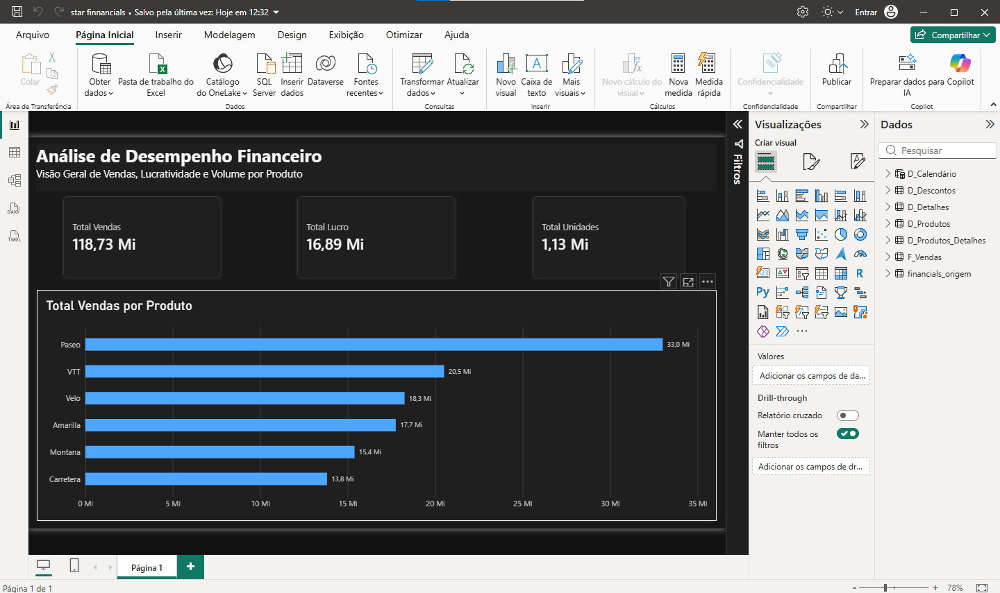
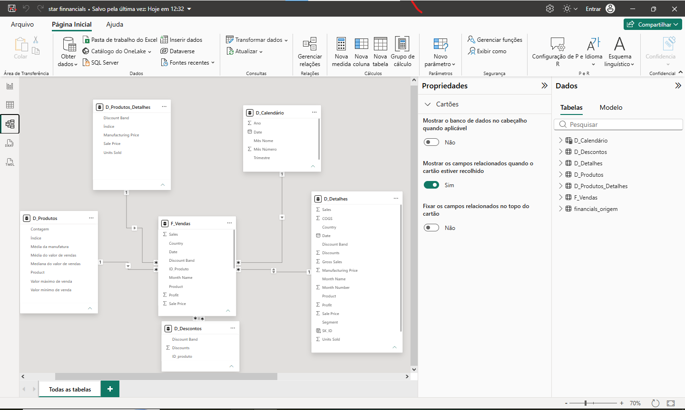

# Modelagem Star Schema e Análise Financeira com Power BI

Projeto desenvolvido para o desafio de modelagem dimensional da **DIO (Digital Innovation One)**
transformando a base *Financial Sample* em um esquema estrela (**Star Schema**) para análise executiva de faturamento, lucratividade e volume de vendas.

## Visão Geral do Dashboard



## Diagrama do Modelo Dimensional (Star Schema)



## Estrutura do Modelo

O modelo foi estruturado no Power Query e na Exibição de Modelo do Power BI separando os registros transacionais das tabelas dimensionais:

* **`F_Vendas` (Tabela Fato):** Centraliza as métricas financeiras (`Sales`, `Profit`, `Units Sold`, `Sale Price`) e as chaves estrangeiras de ligação com as dimensões (`Date`, `ID_Produto`, `Discount Band`, `SK_Detalhes`).
* **`D_Calendário` (Dimensão Tempo):** Tabela de datas gerada via DAX para permitir análises temporais por ano, trimestre e mês.
* **`D_Produtos` (Dimensão Produto):** Agrupa os atributos e estatísticas agregadas por linha de produto (`Product`, médias e faixas de valor).
* **`D_Produtos_Detalhes` (Dimensão Detalhes de Produto):** Armazena especificações complementares de custo de manufatura, preço de venda e faixas de desconto.
* **`D_Descontos` (Dimensão Descontos):** Segmenta as faixas de desconto aplicadas (`Discount Band`) e seus respectivos valores.
* **`D_Detalhes` (Dimensão Detalhes da Transação):** Mantém o contexto granular de país (`Country`), segmento (`Segment`), custos (`COGS`) e vendas brutas (`Gross Sales`), conectada à tabela fato por chave composta (`SK_ID` ↔ `SK_Detalhes`).

## Decisões Técnicas e Tratamento de Dados

* **Prevenção de Dependências Circulares:** Para relacionar `D_Detalhes` e `F_Vendas` com cardinalidade `1:*` sem gerar ciclos de recálculo no motor DAX, foram implementadas chaves compostas em texto (`SK_ID` e `SK_Detalhes`) concatenando data, produto, segmento, país, lucro, unidades vendidas e preço de venda.
* **Saneamento de Colunas:** Tratamento de espaços em branco residuais no mapeamento da coluna de vendas (`[ Sales]`) da base original.
* **Camada de Staging Isolada:** A consulta bruta (`financials_origem`) foi mantida desconectada e oculta da exibição de relatório para preservar a performance e a organização do modelo.

## Funções DAX Utilizadas

### Tabela Calculada (`D_Calendário`)
```dax
D_Calendário = 
ADDCOLUMNS (
    CALENDAR ( MIN ( F_Vendas[Date] ), MAX ( F_Vendas[Date] ) ),
    "Ano", YEAR ( [Date] ),
    "Mês Número", MONTH ( [Date] ),
    "Mês Nome", FORMAT ( [Date], "mmmm" ),
    "Trimestre", "T" & QUARTER ( [Date] )
)
